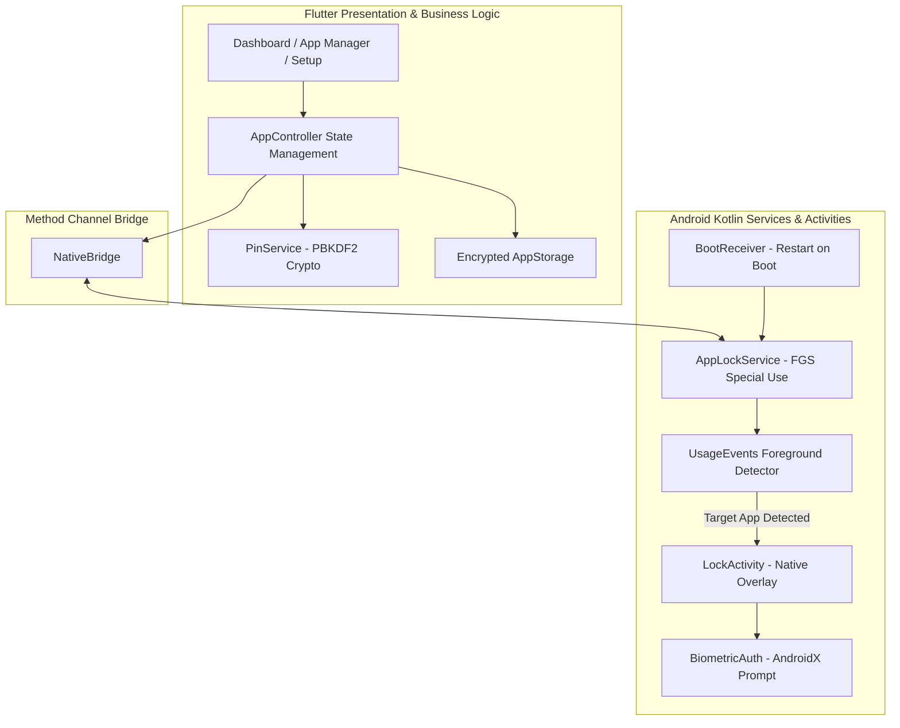

<div align="center">

  

  # Blue Lock

  **Your apps. Your privacy.**  
  *A modern, battery-efficient application locker for Android built with Flutter & Kotlin.*

  [](https://flutter.dev)
  [](https://dart.dev)
  [](https://developer.android.com)
  [](https://kotlinlang.org)
  [](LICENSE)

</div>

---

## 📌 Overview

**Blue Lock** is an Android app protector designed to safeguard sensitive applications with a 4-digit PIN, 6-digit PIN, pattern, password and biometric authentication (Fingerprint / Face Unlock). Built with a hybrid Flutter and native Kotlin architecture, it pairs an aesthetic user interface with low-latency foreground service monitoring to intercept locked apps instantly.

---

## ✨ Features

- 🔐 **Multiple Lock Methods**: Protect apps with a 4-digit PIN, 6-digit PIN, 3 × 3 pattern or password, plus native Biometrics (Fingerprint / Face Unlock via AndroidX `BiometricPrompt`). The method can be changed in Settings after verifying the current credential.
- 🆘 **Verified Recovery**: A 16-character recovery code (80 bits, displayed once during setup) or enrolled biometrics can authorise a forgotten-lock recovery. The new credential is configured and confirmed before the old one is replaced.
- ⚡ **Real-Time Protection**: Lightweight Kotlin background service (`AppLockService`) monitors foreground transitions with minimal battery impact.
- 🛡️ **Bypass-Resistant Lock Screen**: Full-screen native `LockActivity` ignores Back, is excluded from Recents, and survives screen-off/keyguard instead of flashing the protected app.
- 📱 **App Manager**: Browse and search all installed applications; toggle protection with a single tap.
- 🔄 **Reboot Resilience**: Automatically resumes background protection upon device restart via `BootReceiver` (`BOOT_COMPLETED`).
- 🔑 **Cryptographic Security**: Every credential is stored as a salted PBKDF2-HMAC-SHA256 verifier in encrypted storage (`flutter_secure_storage`). The plaintext PIN, pattern, password and recovery code are never persisted or logged.
- 🎨 **Adaptive Branding**: Android 8.0+ adaptive icons and Android 12+ system splash screen tailored with the official Blue Lock aesthetic.

---

## 🏗️ Architecture



---

## 📂 Project Structure

```
blue_lock/
├── android/
│   └── app/src/main/
│       ├── kotlin/com/bluelock/app/
│       │   ├── AppLockService.kt      # Foreground service detecting app switches
│       │   ├── BiometricAuth.kt       # BiometricPrompt integration
│       │   ├── BootReceiver.kt        # Auto-restart on device reboot
│       │   ├── ForegroundDetector.kt  # UsageStatsManager event polling
│       │   ├── LockActivity.kt        # Native lock screen overlay
│       │   ├── LockPrefs.kt           # Shared preferences for locked package list
│       │   └── NativeBridge.kt        # Flutter MethodChannel handler
│       └── res/                       # Adaptive icons & splash configuration
├── assets/
│   ├── app_logo.png                   # Official Blue Lock logo asset
│   └── images/app_logo.png
├── lib/
│   ├── app.dart                       # Root MaterialApp & routing
│   ├── main.dart                      # App entry point
│   ├── core/                          # Theme, state management, storage, crypto
│   ├── features/
│   │   ├── app_lock/                  # Lock screens & session management
│   │   ├── authentication/            # PIN creation, confirmation, change flows
│   │   ├── dashboard/                 # Main home dashboard
│   │   ├── installed_apps/            # Installed apps list & lock toggle
│   │   ├── onboarding/                # First-launch onboarding & splash
│   │   ├── permissions/               # Android permission onboarding
│   │   └── settings/                  # App preferences & security configuration
│   └── shared/                        # Reusable widgets & branding
└── test/                              # Comprehensive unit and widget tests
```

---

## 🚀 Getting Started

### Prerequisites

- [Flutter SDK](https://docs.flutter.dev/get-started/install) (`^3.13.5` / Flutter 3.47+)
- [Android SDK](https://developer.android.com/studio) (API level 24+ / Android 7.0+)
- Java / JDK 17+

### Installation & Run

1. **Clone the repository:**
   ```bash
   git clone https://github.com/Navinkumar-18/Blue-Lock.git
   cd Blue-Lock
   ```

2. **Install Flutter dependencies:**
   ```bash
   flutter pub get
   ```

3. **Run on a physical Android device or emulator:**
   ```bash
   flutter run
   ```

4. **Build release APK:**
   ```bash
   flutter build apk --release
   ```

---

## 🔒 Permissions Required

To effectively monitor and protect apps, Blue Lock requests the following Android permissions:

| Permission | Purpose |
| :--- | :--- |
| `PACKAGE_USAGE_STATS` | Detects when a locked app is brought to the foreground |
| `QUERY_ALL_PACKAGES` | Retrieves the list of installed launchable apps |
| `FOREGROUND_SERVICE` | Maintains background protection reliability |
| `RECEIVE_BOOT_COMPLETED` | Restarts monitoring automatically after device reboot |
| `POST_NOTIFICATIONS` | Displays the persistent foreground service notification |
| `USE_BIOMETRIC` | Enables fingerprint / face authentication |

Blue Lock does **not** request `INTERNET`: all foreground detection and lock
decisions are local, and the app cannot transmit usage, PIN or biometric data.
Android backup is disabled (`allowBackup="false"`), so settings and the PIN
enrolment are intentionally **not** restored by cloud backup or device-to-device
migration; set them up again after moving to a new device.

### Forgot lock and recovery

Tapping **Forgot PIN / pattern / password?** never clears the credential or the
protected-app list. Recovery succeeds only after proving ownership of the
device with one of the factors configured on it:

- **Enrolled biometrics** through the same AndroidX `BiometricPrompt`, or
- the **recovery code** generated after credential setup and shown
  exactly once. It is 16 characters (80 bits) in `XXXX-XXXX-XXXX-XXXX` form;
  only a salted PBKDF2 verifier is stored, so Blue Lock cannot display it again.

After verification the user chooses and confirms a new credential. Only then is
the old verifier replaced. Protected apps, the relock policy, biometric and
other settings are preserved, and every existing unlock session is revoked so
protected apps require the new credential. Recovery-code attempts share the
same persisted failure/lockout counters as the primary credential, so switching
methods cannot bypass a lockout. Cancelling or failing verification leaves the
existing lock fully intact.

Installations created before recovery codes existed have no recovery factor
unless one is generated from **Settings → Recovery code**. If such a device has
no enrolled biometrics, there is deliberately **no in-app reset**: the only
platform-provided option is clearing Blue Lock's app data in Android Settings,
which removes the credential, protected-app selections and all settings and
stops protection until setup is completed again. Android does not let an app
prevent data clearing or uninstall, so this limitation is platform-enforced and
cannot be removed from inside Blue Lock.

### Battery and reliability

- Polls foreground transitions every **500 ms while the screen is on** and once
  per **60 s while the screen is off**, with an immediate poll on screen-on /
  unlock.
- Reads UsageStats events incrementally (last query + a 250 ms overlap) instead
  of re-scanning a fixed 5 s window on every tick.
- Uses a `specialUse` foreground service, `START_STICKY`, boot/update recovery
  and a 15-minute alarm watchdog for OEMs that kill background services.
- Some OEMs still require manual battery-optimisation exemption; Android will
  not restart an app after the user force-stops it.

---

## 🧪 Testing

Run the Flutter test suite (108 unit/widget tests):

```bash
flutter test
```

Run Flutter code analysis:

```bash
flutter analyze
```

Run the native Kotlin unit tests for the app module:

```bash
cd android && ./gradlew :app:testDebugUnitTest
```

> Running `./gradlew testDebugUnitTest` at the Android project root also runs
> the dependencies' own Robolectric tests. On a Java 17 toolchain the current
> `shared_preferences_android` suite fails because Android SDK 36 requires Java
> 21; use the `:app:` task above to test Blue Lock's native code, or run Gradle
> with JDK 21.

---

## 📄 License

This project is licensed under the Apache License 2.0 - see the [LICENSE](LICENSE) file for details.
