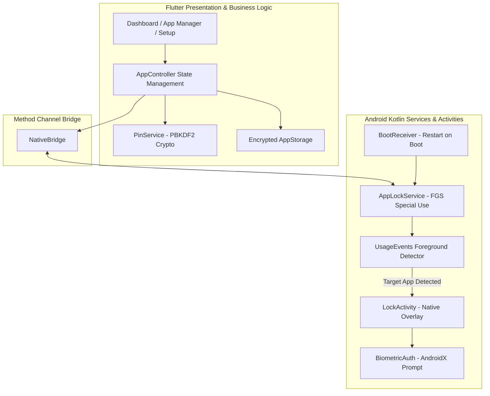

<div align="center">

  

  # Blue Lock

  **Your apps. Your privacy.**  
  *A modern, battery-efficient application locker for Android built with Flutter & Kotlin.*

  [](https://flutter.dev)
  [](https://dart.dev)
  [](https://developer.android.com)
  [](https://kotlinlang.org)
  [](LICENSE)

</div>

---

## 📌 Overview

**Blue Lock** is an Android app protector designed to safeguard sensitive applications with a PIN and biometric authentication (Fingerprint / Face Unlock). Built with a hybrid Flutter and native Kotlin architecture, it pairs an aesthetic user interface with low-latency foreground service monitoring to intercept locked apps instantly.

---

## ✨ Features

- 🔐 **Dual Security Modes**: Unlock apps with a 4-digit PIN or native Biometrics (Fingerprint / Face Unlock via AndroidX `BiometricPrompt`).
- ⚡ **Real-Time Protection**: Lightweight Kotlin background service (`AppLockService`) monitors foreground transitions with minimal battery impact.
- 🛡️ **Bypass-Resistant Lock Screen**: Native `LockActivity` prevents dismissal via Back gesture or Recent Apps view (`excludeFromRecents`, `noHistory`).
- 📱 **App Manager**: Browse and search all installed applications; toggle protection with a single tap.
- 🔄 **Reboot Resilience**: Automatically resumes background protection upon device restart via `BootReceiver` (`BOOT_COMPLETED`).
- 🔑 **Cryptographic Security**: PIN verifiers are salted and hashed using PBKDF2 (HMAC-SHA256) and stored in encrypted storage (`flutter_secure_storage`).
- 🎨 **Adaptive Branding**: Android 8.0+ adaptive icons and Android 12+ system splash screen tailored with the official Blue Lock aesthetic.

---

## 🏗️ Architecture



---

## 📂 Project Structure

```
blue_lock/
├── android/
│   └── app/src/main/
│       ├── kotlin/com/bluelock/app/
│       │   ├── AppLockService.kt      # Foreground service detecting app switches
│       │   ├── BiometricAuth.kt       # BiometricPrompt integration
│       │   ├── BootReceiver.kt        # Auto-restart on device reboot
│       │   ├── ForegroundDetector.kt  # UsageStatsManager event polling
│       │   ├── LockActivity.kt        # Native lock screen overlay
│       │   ├── LockPrefs.kt           # Shared preferences for locked package list
│       │   └── NativeBridge.kt        # Flutter MethodChannel handler
│       └── res/                       # Adaptive icons & splash configuration
├── assets/
│   ├── app_logo.png                   # Official Blue Lock logo asset
│   └── images/app_logo.png
├── lib/
│   ├── app.dart                       # Root MaterialApp & routing
│   ├── main.dart                      # App entry point
│   ├── core/                          # Theme, state management, storage, crypto
│   ├── features/
│   │   ├── app_lock/                  # Lock screens & session management
│   │   ├── authentication/            # PIN creation, confirmation, change flows
│   │   ├── dashboard/                 # Main home dashboard
│   │   ├── installed_apps/            # Installed apps list & lock toggle
│   │   ├── onboarding/                # First-launch onboarding & splash
│   │   ├── permissions/               # Android permission onboarding
│   │   └── settings/                  # App preferences & security configuration
│   └── shared/                        # Reusable widgets & branding
└── test/                              # Comprehensive unit and widget tests
```

---

## 🚀 Getting Started

### Prerequisites

- [Flutter SDK](https://docs.flutter.dev/get-started/install) (`^3.13.5` / Flutter 3.47+)
- [Android SDK](https://developer.android.com/studio) (API level 26+ / Android 8.0+)
- Java / JDK 17+

### Installation & Run

1. **Clone the repository:**
   ```bash
   git clone https://github.com/Navinkumar-18/Blue-Lock.git
   cd Blue-Lock
   ```

2. **Install Flutter dependencies:**
   ```bash
   flutter pub get
   ```

3. **Run on a physical Android device or emulator:**
   ```bash
   flutter run
   ```

4. **Build release APK:**
   ```bash
   flutter build apk --release
   ```

---

## 🔒 Permissions Required

To effectively monitor and protect apps, Blue Lock requests the following Android permissions:

| Permission | Purpose |
| :--- | :--- |
| `PACKAGE_USAGE_STATS` | Detects when a locked app is brought to the foreground |
| `QUERY_ALL_PACKAGES` | Retrieves the list of installed launchable apps |
| `FOREGROUND_SERVICE` | Maintains background protection reliability |
| `RECEIVE_BOOT_COMPLETED` | Restarts monitoring automatically after device reboot |
| `POST_NOTIFICATIONS` | Displays the persistent foreground service notification |
| `USE_BIOMETRIC` | Enables fingerprint / face authentication |

---

## 🧪 Testing

Run the test suite:

```bash
flutter test
```

Run code analysis:

```bash
flutter analyze
```

---

## 📄 License

This project is licensed under the Apache License 2.0 - see the [LICENSE](LICENSE) file for details.
